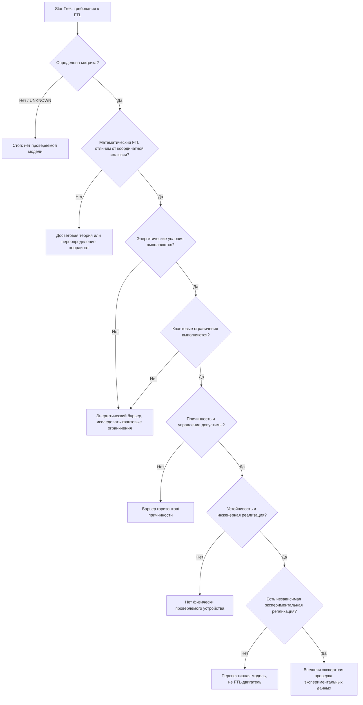

# 🖖 QuantDeus Warp Lab — Star Trek → бинарные научные ветви

**Дата:** 18 октября 2026 · **Статус:** исследование, не созданный FTL-двигатель.

## Начальные требования из Star Trek

Фантастическая система: реактор материи/антиматерии, управление потоком энергии, варп-катушки, управляемый пузырь пространства-времени и подпространственный эффект. Это **источник инженерных требований**, но не эмпирическое свидетельство существования «подпространства». См.: [Star Trek: The Science Behind Discovery's Burn](https://www.startrek.com/news/the-science-behind-discoverys-burn).

Из этого создаём инженерные наблюдаемые величины: `g_mu_nu(x,t)`, `T_mu_nu`, скорость доставки между удалёнными событиями, величину кривизны/приливов, управление полем, устойчивость, мощность и длительность воспроизводимого эксперимента.

## Топологическое дерево бинарных решений



**Третье значение UNKNOWN:** пока нет свидетельства ни за, ни против. Код записывает его отдельно, а не выдаёт за FAIL или PASS.

## Три ветки кандидатов

| Кандидат | Формальная метрика | Формальное FTL | Энергетический барьер | Вердикт |
|---|---|---|---|---|
| Star Trek | Не определена | Сюжетный, не доказанный | Не исследован | Вдохновение для постановки задач |
| Алькубьерре 1994 | Да | Да, в математической модели | Исходная метрика нарушает WEC | Не физически реализованный FTL |
| Фукс и соавт. 2024 | Да | **Нет, досветовая** | Выполняются энергетические условия построенной досветовой модели | Полезная теория, но не FTL |

Все они требуют ещё специальных проверок на причинность, устойчивость, реальные источники поля и опыт.

## Аудит литературы через Scholar Sidekick

Все восемь библиографических записей совпали с реальными источниками, 0 отзывов обнаружено при запросе (18 октября 2026). Это **не означает**, что все физические утверждения статей экспериментально доказаны.

1. [Alcubierre (1994)](https://doi.org/10.1088/0264-9381/11/5/001)
2. [Pfenning & Ford (1997)](https://doi.org/10.1088/0264-9381/14/7/011)
3. [Olum (1998)](https://doi.org/10.1103/PhysRevLett.81.3567)
4. [Bobrick & Martire (2021)](https://doi.org/10.1088/1361-6382/abdf6e)
5. [Santiago, Schuster & Visser (2022)](https://doi.org/10.1103/PhysRevD.105.064038)
6. [Fuchs et al. (2024)](https://doi.org/10.1088/1361-6382/ad26aa)
7. [Garattini & Zatrimaylov (2024)](https://doi.org/10.1016/j.physletb.2024.138910)
8. [Le (2026), arXiv:2602.18023](https://arxiv.org/abs/2602.18023) — **препринт**, статус рецензирования не подтверждён.

## Агенты

- **Scout**: новые публикации, независимые исследования, проверка DOI и arXiv.
- **Archivist**: сохраняет библиографию, версии, лицензии и ссылки.
- **Analyst**: переводит каждый источник в метрику/вопрос/проверяемый прогноз.
- **Sherlock/Risk**: пытается опровергнуть каждую ветку: WEC/NEC для всех направлений, QEI, горизонты, причинность, устойчивость и EFT.
- **Builder**: вычислительные тесты, графы, оценки масштабов.
- **QA Triad**: красная ветка остаётся красной; без независимого эксперимента запрещено утверждение, что FTL получен.

## Воспроизводимость

```bash
python research/warp-literature/binary_gate.py
python -m unittest discover -s research/warp-literature/tests -v
```

Выход: JSON с последовательностью всех веток по каждому кандидату, статусами и физическими ограничениями. **Скрипт не способен объявить, что FTL доказан, по одним записям базы данных**.

Дальше: независимая репликация исходной энергетической плотности Алькубьерре и расчёт NEC/WEC для набора наблюдателей; проверка иных геометрий в WarpFactory с раздельными отчётами.

Данный инструмент — сортировщик научных гипотез и библиографических свидетельств, не варп-двигатель.
